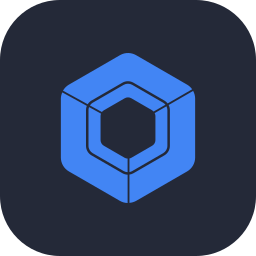
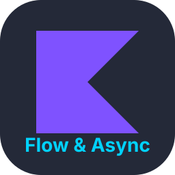
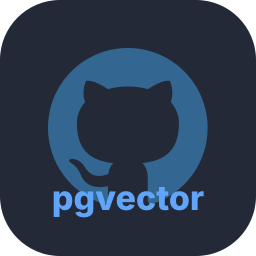
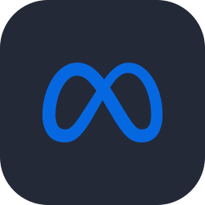
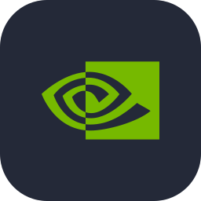
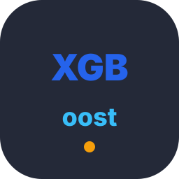

<div align="center">

  <!-- Aesthetic Header Banner with Twinkling Star Animation -->
  

  <!-- Dynamic Typing Subtitle -->
  <a href="https://github.com/aditya129456">
    
  </a>

  <br/>

  <!-- Status & Profile Badges -->
  <p align="center">
    
    
    
  </p>

  <!-- Connect & Social Buttons -->
  <p align="center">
    <a href="https://linkedin.com/in/YOUR_LINKEDIN"></a>
    <a href="https://leetcode.com/YOUR_LEETCODE"></a>
    <a href="mailto:YOUR_EMAIL@example.com"></a>
    <a href="https://twitter.com/YOUR_TWITTER"></a>
  </p>

</div>


### 👨‍💻 About Me


```yaml
name: Aditya
institute: Indian Institute of Information Technology, Allahabad (IIIT-A)
degree: B.Tech (3rd Year)
focus_areas:
  - Full-Stack Web Development (Next.js, Node.js, FastAPI)
  - Native Android (Jetpack Compose, Coroutines & Flow)
  - Applied Machine Learning & Vector Search (PyTorch, FAISS, pgvector, CUDA)
  - High-Performance Algorithms & Systems (C++, C)
current_status: Building real-world projects & exploring modern AI infra
```

- 🎓 **Undergrad**: 3rd Year B.Tech student at **Indian Institute of Information Technology, Allahabad**.
- 💡 **Engineering Passion**: Crafting end-to-end full-stack applications, modern reactive Android experiences, and scalable AI/ML pipelines with accelerated vector search.
- 🔭 **Currently Exploring**: LLM application architectures, vector embeddings, high-throughput backend systems, and CUDA optimization.
- 🤝 **Open for**: Collaborating on innovative open-source projects, hackathons, and research initiatives.


### 🛠️ Tech Arsenal

#### 💻 Programming Languages
> Core languages for competitive programming, low-level systems, algorithmic problem solving, and application development.

<p>
  
</p>

#### 🌐 Frontend & Web Engineering
> Modern responsive web applications, server-rendered UIs, and dynamic client experiences.

<p>
  
</p>

#### ⚙️ Backend, APIs & Microservices
> Asynchronous, high-throughput backend services and clean RESTful API design.

<p>
  
</p>

#### 📱 Native Android Development
> Modern declarative mobile engineering with clean architecture and reactive streams.

<p>
  
  
  
</p>

#### 🗄️ Databases & Vector Storage
> Relational, NoSQL, in-memory caching, and similarity search for AI embeddings.

<p>
  
  
  
</p>

#### 🧠 Machine Learning, AI & High-Performance Computing
> Deep learning modeling, pretrained transformers, tabular models, and GPU acceleration.

<p>
  
  
  
  
</p>

#### 🛠️ Tooling, DevOps & Infrastructure
> Reproducible environments, automation, version control, and Linux systems.

<p>
  
</p>


### 📊 GitHub Activity & Metrics

<div align="center">

  <!-- Side-by-side Stats & Top Languages with matching border styling -->
  <table border="0">
    <tr align="center">
      <td>
        
      </td>
      <td>
        
      </td>
    </tr>
  </table>

  <br/>

  <!-- Contribution Streak with border styling -->
  

  <br/><br/>

  <!-- Dynamic Programmer Joke Card with matching border styling -->
  

</div>


### 🐍 Contribution Arcade

<div align="center">

  <picture>
    <source media="(prefers-color-scheme: dark)" srcset="https://raw.githubusercontent.com/aditya129456/aditya129456/output/github-contribution-grid-snake-dark.svg">
    <source media="(prefers-color-scheme: light)" srcset="https://raw.githubusercontent.com/aditya129456/aditya129456/output/github-contribution-grid-snake.svg">
    
  </picture>

</div>

<div align="center">

  <!-- Animated Coding Mascot -->
  <br/>
  
  <br/>

  <!-- Footer Banner with Twinkling Star Animation -->
  

  <p><i>"Talk is cheap. Show me the code." — Linus Torvalds</i></p>

</div>
